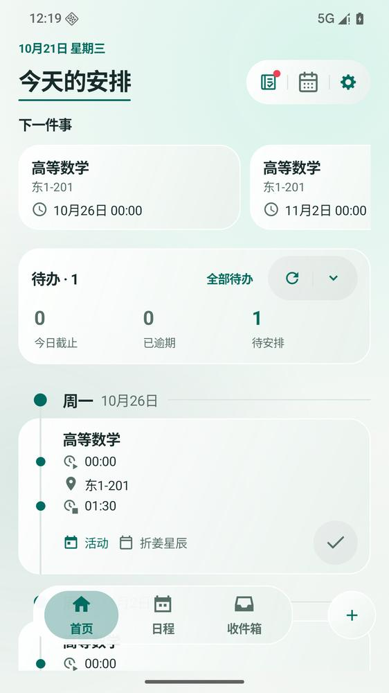
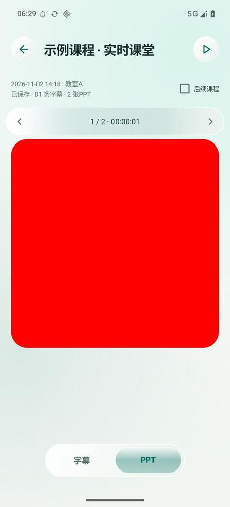

# 界面组件怎么称呼

讨论界面时，用下面的中文名称指明对象；代码入口沿用现有名称。

## 首页：主导航栏、操作组、内容卡片

| 名称 | 图中位置与用途 | 代码入口 |
| --- | --- | --- |
| **主导航栏** | 底部「首页／日程／收件箱」，切换主页面 | `DockNavigationLayout`、`DashboardDockChrome` |
| **操作组（胶囊）** | 右上作业、系统日程、设置图标及其分隔；一组相关操作 | `HeaderActionGroup` |
| **内容卡片** | 「下一件事」、待办统计、时间线记录等内容表面 | `UiStyle.card` |

「＋」是独立新增按钮，与主导航栏分开称呼。

## 课堂 PPT：标题栏、分页条、图片框、视图选择栏

| 名称 | 图中位置与用途 | 代码入口 |
| --- | --- | --- |
| **标题栏** | 顶部返回、课程名与右侧操作 | 本页为 `SettingsPageLayout.header`；多视图工作区为 `WorkspacePageHeader` |
| **分页条** | 图片上方「1 / 2 · 00:00:01」及两侧箭头，切换图片或结果页 | `DateIntervalBar` |
| **图片框** | 中部红色示例图片所在区域，展示与翻动图片 | `ImageSlidePager` |
| **视图选择栏** | 底部「字幕／PPT」，切换当前页面的内容视图 | `DockNavigationLayout` |

课堂顶部的「课表／课堂／监视／历史」也称**视图选择栏**。

## 其他常用名称

| 名称 | 在哪里、做什么 | 代码入口 |
| --- | --- | --- |
| **状态筛选栏** | 日程的「待处理／待安排／历史／全部」，筛选同一列表 | `DockNavigationLayout`；标签放不下时使用 `UiDialogs.choiceDialog` |
| **日期切换条** | 显示日期或区间，切换前后一天、一周或一月 | `DateIntervalBar` |
| **字段选择器** | 如历史的课程、排序字段；显示当前值，点击选择 | `UiStyle.fieldTrigger` |
| **菜单／确认浮层** | 覆盖页面的选项菜单或取消／确认面板 | `UiDialogs` |
| **全屏图片页** | 点击图片后打开的大图，支持缩放、翻图与保存 | `AttachmentViewerActivity`，内部复用 `ImageSlidePager` |

主导航栏、视图选择栏、状态筛选栏按用途区分，虽可共用 `DockNavigationLayout`，讨论时仍分别称呼。日期切换条与分页条同理，不能只凭外形混称。

## 高光分三种说

- **选中高光**：选择栏中表示当前选项的底色，如「首页」或「PPT」下方的主题色。
- **按压高光**：按下按钮或菜单时出现的填充／涟漪反馈。
- **定位强调**：跳到目标作业后，短暂出现的主题色边框与淡底。

实现职责见[公共 UI 库](ui-library.md)，外观与动效以 [UI 规范](ui-style-contract.md)和[交互基线](ui-interaction-baseline.md)为准。
